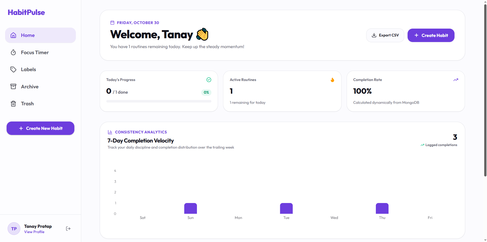
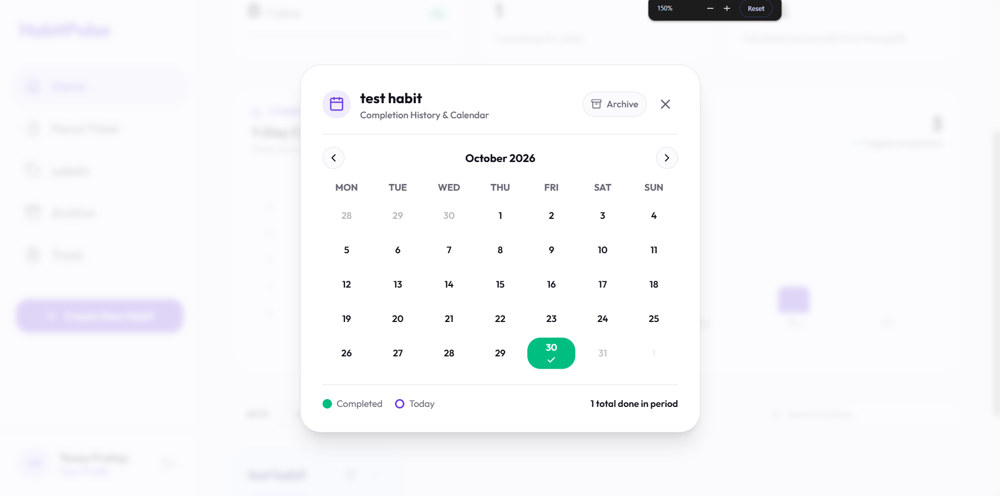
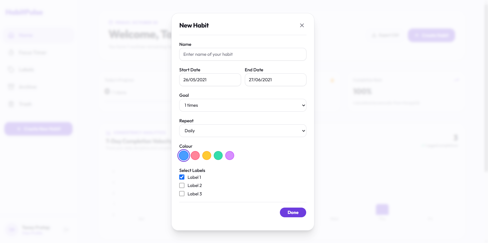
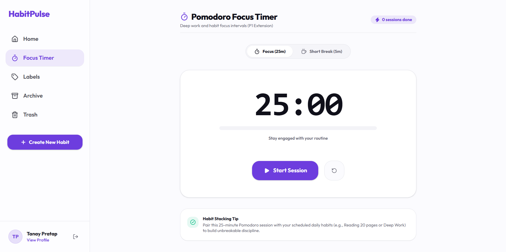
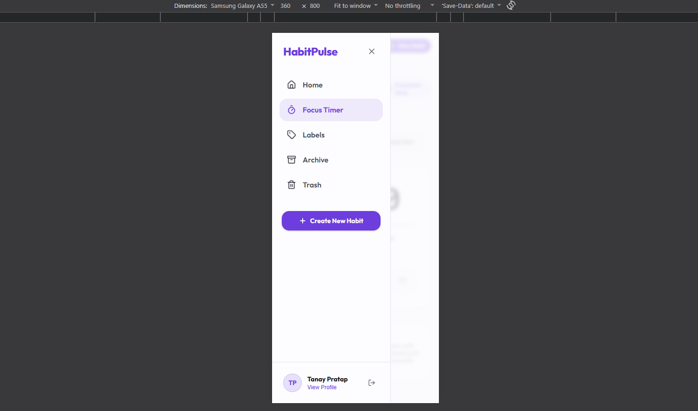

# HabitPulse — Full-Stack Habit Tracker

> **Full-Stack Track Submission** | Personal Habit & Discipline Tracker built with React 19, TypeScript, Express 5, and MongoDB.

---

## 🔗 Live Deployments & References

| Resource                   | Link                                                                                                                                     |
| :------------------------- | :--------------------------------------------------------------------------------------------------------------------------------------- |
| **Live Frontend**          | [https://habit-pulse-lokeshwar.vercel.app/](https://habit-pulse-lokeshwar.vercel.app/)                                                   |
| **Live Backend API**       | [https://habit-pulse-lokeshwar-api.vercel.app/](https://habit-pulse-lokeshwar-api.vercel.app/)                                           |
| **Postman API Collection** | [https://www.postman.com/lokeshwar-dewangan/workspace/habit-tracker](https://www.postman.com/lokeshwar-dewangan/workspace/habit-tracker) |
| **Figma Design Reference** | [Figma Habit Tracker App](https://www.figma.com/file/37Ky6s3RjFkuEwUnzhdtxI/Habit-Tracker-App?node-id=0%3A1)                             |
| **GitHub Repository**      | [https://github.com/lokeshwardewangan/habit-tracker](https://github.com/lokeshwardewangan/habit-tracker)                                 |

---

## 📸 Application Screenshots

> _Add application screenshots to the `docs/screenshots/` folder using the relative paths below._

| Screen                              | Preview                                                             | Description                                                                                                      |
| :---------------------------------- | :------------------------------------------------------------------ | :--------------------------------------------------------------------------------------------------------------- |
| **1. Main Workspace & Dashboard**   |             | Trailing 7-day consistency chart, quick daily checkoffs, dynamic completion percentage, and active routines.     |
| **2. Interactive Calendar History** |  | Monthly checkoff history inspection modal with date-level completion toggling and future-date safeguards.        |
| **3. Habit Creation & Management**  |           | Modal for creating and editing habits with Zod schema validation, frequency selection, and custom label tagging. |
| **4. Pomodoro Focus Timer (P1)**    |      | 25-minute focus session timer with interval controls, audio alert cues, and habit focus pairing.                 |
| **5. Mobile Drawer Navigation**     |   | Responsive hamburger drawer navigation providing seamless mobile access across all workspace views.              |

---

## 🎥 Walkthrough Video

> **Video Link:** _[Insert Loom / YouTube / Drive Walkthrough Link Here]_
>
> _A 3–5 minute video demonstration walking through user registration, habit creation, daily checkoffs, calendar history, statistics computation, and mobile responsiveness._

---

## 🛠 Tech Stack

- **Frontend:**
   - React 19, TypeScript, Vite
   - Tailwind CSS v4, `@fontsource/outfit`, shadcn/ui primitives
   - TanStack Query v5 (React Query) for optimistic updates & cache synchronization
   - React Hook Form + Zod for runtime schema validation
   - Axios with interceptors, Recharts for 7-day analytics, Lucide React icons, Sonner toast notifications
- **Backend:**
   - Node.js (ESM), Express 5
   - MongoDB & Mongoose 9 with compound indexing
   - JSON Web Tokens (JWT) & bcryptjs password hashing
   - Zod request validator middlewares
- **Tooling & Monorepo:**
   - `bun` workspaces (monorepo managing `packages/client` and `packages/server`)
   - Supertest + `mongodb-memory-server` for zero-dependency backend integration testing
   - Vitest + React Testing Library + `happy-dom` for frontend component and route guard testing
   - Oxlint for lightning-fast linting and Prettier for formatting

---

## 🏗 Project Architecture & Structure

The repository is structured as a Bun monorepo cleanly separating frontend and backend packages:

```text
habit-tracker-take-home/
├── packages/
│   ├── client/                     # Frontend Application (React 19 + Vite)
│   │   ├── src/
│   │   │   ├── api/ & services/    # Axios HTTP instance, interceptors, and typed API services
│   │   │   ├── components/         # Reusable UI components
│   │   │   │   ├── auth/           # ProtectedRoute and PublicRoute guard wrappers
│   │   │   │   ├── habits/         # HabitCard, NewHabitModal, CalendarHistoryModal
│   │   │   │   ├── layout/         # AppLayout, Header, Sidebar, TopSearchHeader
│   │   │   │   └── ui/             # Design system components (button, card, badge, input, etc.)
│   │   │   ├── context/            # AuthContext managing user session, tokens, and login/logout
│   │   │   ├── features/           # Specialized modules (WeeklyConsistencyChart, CSV export)
│   │   │   ├── hooks/              # TanStack Query hooks (useHabits, useToggleCompletion, etc.)
│   │   │   ├── pages/              # Route views (HomePage, LoginPage, SignupPage, ArchivePage, etc.)
│   │   │   ├── schemas/            # Client Zod validation schemas
│   │   │   ├── test/               # Vitest + RTL component tests and setup
│   │   │   └── types/              # Domain models and TypeScript interfaces
│   │   ├── package.json
│   │   ├── vite.config.ts
│   │   └── vitest.config.ts
│   │
│   └── server/                     # Backend API (Express 5 + MongoDB)
│       ├── src/
│       │   ├── config/             # Typed environment parsing (env.ts) and MongoDB connection (db.ts)
│       │   ├── controllers/        # Express handlers (auth, habit, completion, dashboard)
│       │   ├── middlewares/        # JWT authentication, Zod request validator, centralized errorHandler
│       │   ├── models/             # Mongoose schemas & compound unique indexes (User, Habit, Completion)
│       │   ├── repositories/       # Isolated database queries with strict tenant enforcement
│       │   ├── routes/             # Route modules (/api/auth, /api/habits, /api/dashboard)
│       │   ├── services/           # Business logic, password hashing, dynamic stats formula
│       │   ├── types/              # Ambient type augmentations (express.d.ts)
│       │   ├── utils/              # Custom domain errors and standard API response envelopes
│       │   └── validators/         # Request input Zod schemas
│       ├── tests/                  # Supertest integration test suite
│       └── package.json
│
├── docker-compose.yml              # Local containerized full-stack deployment
├── README.md                       # Documentation & submission reference
└── bun.lock                        # Workspace lockfile
```

### Architectural Layering (Backend)

1. **Routes Layer (`src/routes/`):** Declares route endpoints and binds validation and auth middlewares.
2. **Controllers Layer (`src/controllers/`):** Handles incoming HTTP requests, unpacks parameters/body, and delegates to services.
3. **Services Layer (`src/services/`):** Contains pure domain logic, statistical formulas, and security checks.
4. **Repositories Layer (`src/repositories/`):** Isolates Mongoose queries and enforces `userId` filtering on every read/write operation.
5. **Models Layer (`src/models/`):** Enforces data integrity rules, schemas, and compound unique constraints at the database level.

---

## ✨ Implemented Features

### Must-Have Core Requirements (P0)

- [x] **Authentication & Session Persistence:** Secure JWT-based signup, login, and logout. Passwords hashed using `bcryptjs` with salt rounds. Protected routes guard private views; reverse `PublicRoute` redirects signed-in users away from auth pages.
- [x] **Strict Tenant Isolation:** Every database read, mutation, and completion toggle is scoped to the authenticated user's ID. Cross-tenant access attempts return 404 or 401.
- [x] **Complete Habit Lifecycle:** Full CRUD management for habits (Name, optional Description, Start Date, and Frequency). Habits can be edited, archived to an archive view, restored, or permanently deleted.
- [x] **Idempotent Completion Tracking:** Check off or uncheck daily habits with zero risk of duplicate records. Handled via atomic operations and database compound unique indexes.
- [x] **Calendar History View:** Interactive month-view calendar modal enabling historical checkoffs, month navigation, and completion state inspection.
- [x] **Dynamic Statistics Engine:** Computes real-time statistics aggregated from database completion records:
   - Active habits count
   - Completions achieved in current week (Monday–Sunday)
   - Period completion rate (%) using an eligible-days denominator

### Optional Enhancements (P1)

- [x] **Pomodoro Focus Timer (`/timer`):** Integrated 25-minute focus session timer with audio signals, pause/reset, and visual circular progress ring.
- [x] **7-Day Trailing Analytics Chart:** Dynamic Recharts bar graph displaying daily completed habit volume over the trailing 7 days.
- [x] **CSV Data Export:** One-click download of habits, start dates, frequencies, and completion counts formatted as standard `.csv`.
- [x] **Mobile Drawer Navigation:** Fully responsive interface featuring a collapsible mobile navigation drawer.
- [x] **Tag & Label Filtering (`/labels`):** Group and filter habits by custom categorization labels.

---

## 📡 API Reference

Interactive testing is available via the published [Postman Collection](https://www.postman.com/lokeshwar-dewangan/workspace/habit-tracker).

Base URL: `/api` (Production: `https://habit-pulse-lokeshwar-api.vercel.app/api`)

### 1. Authentication Endpoints

| Method | Endpoint       | Request Body                               | Description                                                | Auth Required | Status |
| :----- | :------------- | :----------------------------------------- | :--------------------------------------------------------- | :-----------: | :----: |
| `POST` | `/auth/signup` | `{ firstName, lastName, email, password }` | Registers a new user and sets auth cookie / returns token  |      No       | `201`  |
| `POST` | `/auth/login`  | `{ email, password }`                      | Authenticates credentials and returns user profile & token |      No       | `200`  |
| `POST` | `/auth/logout` | None                                       | Clears authentication session cookie                       |      No       | `200`  |
| `GET`  | `/auth/me`     | None                                       | Returns profile of currently authenticated user            |    **Yes**    | `200`  |

### 2. Habit Lifecycle Endpoints

| Method   | Endpoint                | Request Body / Params                             | Description                                           | Auth Required | Status |
| :------- | :---------------------- | :------------------------------------------------ | :---------------------------------------------------- | :-----------: | :----: |
| `GET`    | `/habits`               | Query: `?status=ACTIVE\|ARCHIVED`                 | Lists all habits belonging to authenticated user      |    **Yes**    | `200`  |
| `POST`   | `/habits`               | `{ name, description?, startDate, frequency }`    | Creates a new habit routine                           |    **Yes**    | `201`  |
| `GET`    | `/habits/:id`           | Param: `:id`                                      | Fetches single habit details                          |    **Yes**    | `200`  |
| `PATCH`  | `/habits/:id`           | `{ name?, description?, startDate?, frequency? }` | Updates habit properties (preserves past completions) |    **Yes**    | `200`  |
| `DELETE` | `/habits/:id`           | Param: `:id`                                      | Permanently deletes habit and associated completions  |    **Yes**    | `200`  |
| `POST`   | `/habits/:id/archive`   | Param: `:id`                                      | Soft-archives habit (excludes from active dashboard)  |    **Yes**    | `200`  |
| `POST`   | `/habits/:id/unarchive` | Param: `:id`                                      | Restores an archived habit back to active status      |    **Yes**    | `200`  |

### 3. Completion Tracking Endpoints

| Method   | Endpoint                        | Query / Route Params             | Description                                               | Auth Required | Status |
| :------- | :------------------------------ | :------------------------------- | :-------------------------------------------------------- | :-----------: | :----: |
| `PUT`    | `/habits/:id/completions/:date` | `:id`, `:date` (`YYYY-MM-DD`)    | Marks habit complete for date (idempotent, no duplicates) |    **Yes**    | `200`  |
| `DELETE` | `/habits/:id/completions/:date` | `:id`, `:date` (`YYYY-MM-DD`)    | Un-marks completion for specified date                    |    **Yes**    | `200`  |
| `GET`    | `/habits/:id/completions`       | `?from=YYYY-MM-DD&to=YYYY-MM-DD` | Retrieves historical completion records within date range |    **Yes**    | `200`  |

### 4. Dashboard & Analytics Endpoints

| Method | Endpoint           | Query Params                     | Description                                               | Auth Required | Status |
| :----- | :----------------- | :------------------------------- | :-------------------------------------------------------- | :-----------: | :----: |
| `GET`  | `/dashboard/stats` | `?from=YYYY-MM-DD&to=YYYY-MM-DD` | Returns active counts, weekly volume, and completion rate |    **Yes**    | `200`  |
| `GET`  | `/health`          | None                             | Base service health check and server timestamp            |      No       | `200`  |

---

## 📐 Assumptions & Engineering Decisions

1. **Date & Timezone Normalization:**
   - Habit completions are anchored to discrete calendar dates formatted as ISO strings (`YYYY-MM-DD`) rather than UTC timestamps.
   - This eliminates common timezone bugs where a completion recorded at 11:30 PM shifts to the next calendar day when converted to UTC on the server.
   - The user cannot check off future dates (`isFuture(day)` validation on client and validation on server).

2. **Idempotency & Duplicate Prevention:**
   - Duplicate prevention is guaranteed at the database engine level via Mongoose compound unique index:
      ```typescript
      completionSchema.index({ habitId: 1, date: 1 }, { unique: true });
      ```
   - Invoking `PUT /habits/:id/completions/:date` multiple times for the same date safely resolves as an idempotent operation rather than creating redundant entries or throwing uncaught 500 errors.

3. **Documented Completion Rate Formula:**
   - Rather than dividing total completions by an arbitrary date range, the completion rate denominator is dynamically calculated to avoid penalizing users for days before a habit was created or days in the future:
     $$\text{Completion Rate (\%)} = \frac{\text{Total Actual Completions in Period}}{\sum_{\text{active habits}} \text{Eligible Days in Period}} \times 100$$
   - _Eligible Days:_ $\max(0, \min(\text{periodEnd}, \text{today}) - \max(\text{periodStart}, \text{habit.startDate}) + 1)$.

4. **Archiving vs. Permanent Deletion:**
   - **Archived Habits:** Retain full historical completion records for retrospective review, but are excluded from active dashboard widgets, weekly goals, and daily checklists (`status: "ARCHIVED"`).
   - **Deleted Habits:** Hard-deletes the habit record along with cascading cleanup of associated completions.

5. **Tenant Isolation:**
   - Authentication middleware extracts `req.user.id` directly from the verified JWT payload.
   - The repository layer explicitly injects `userId` into every MongoDB query filter (`{ _id: habitId, userId }`). It is impossible for User A to inspect, toggle, or delete User B's habits.

6. **Dual Authentication Strategy (Cookies + Bearer Token):**
   - The backend issues an `httpOnly`, `SameSite: Lax` cookie upon login/signup for secure browser session handling.
   - To support deployments where client and backend reside on distinct Vercel subdomains, the client API interceptor also caches the token in `localStorage` and attaches fallback `Authorization: Bearer <token>` headers automatically.

---

## ⚠️ Known Limitations & Edge Cases

1. **Weekly Frequency Granularity:**
   - While habits support both `DAILY` and `WEEKLY` frequency types, completion checkoffs operate on a calendar day (`YYYY-MM-DD`) granularity. Advanced target goals (such as _"complete 3 times any day this week"_) are represented visually rather than enforcing day-of-week quotas.
2. **Pomodoro Timer Session State:**
   - The focus timer in `/timer` runs client-side in React component state. Focus intervals and break logs are not currently persisted to MongoDB.
3. **Serverless Cold Starts:**
   - On free-tier Vercel serverless compute and shared MongoDB Atlas tiers, initial requests following a period of inactivity may incur a cold-start latency while establishing the TLS connection pool.

---

## ⚙️ Environment Variables

### Backend (`packages/server/.env`)

```env
PORT=5000
NODE_ENV=production
MONGO_URI=mongodb+srv://<user>:<password>@cluster.mongodb.net/habit_tracker
JWT_SECRET=your-secure-jwt-secret-key
JWT_EXPIRES_IN=7d
CLIENT_URL=https://habit-pulse-lokeshwar.vercel.app
```

### Frontend (`packages/client/.env`)

```env
# Leave empty in local dev to use the Vite proxy; configure in Vercel for live backend
VITE_API_URL=https://habit-pulse-lokeshwar-api.vercel.app
```

---

## 🚀 Local Development Setup

### Option A: Using Bun (Local)

Prerequisites: [Bun](https://bun.sh/) (v1.2+) and a running MongoDB instance.

```bash
# 1. Clone repository
git clone https://github.com/lokeshwardewangan/habit-tracker.git
cd habit-tracker

# 2. Install workspace dependencies
bun install

# 3. Start full-stack application concurrently (server on :5000, client on :5173)
bun run dev
```

### Option B: Quick Evaluation via Docker Compose

Run the entire full-stack environment (Frontend, Backend, and MongoDB) with zero local runtime dependencies:

```bash
docker compose up --build
```

- **Frontend App:** [http://localhost:5173](http://localhost:5173)
- **Backend API:** [http://localhost:5000](http://localhost:5000)
- **MongoDB Database:** `localhost:27017`

---

## 🧪 Automated Testing & Verification

All automated tests run in-memory with zero external database dependencies.

```bash
# 1. Run full test suite across workspace (Server integration + Client component tests)
bun run test

# 2. Run backend integration tests specifically (Supertest + In-Memory Mongo)
cd packages/server && bun test

# 3. Run frontend unit/component tests (Vitest + React Testing Library)
cd packages/client && bun run test

# 4. Run frontend linter (Oxlint)
cd packages/client && bun run lint

# 5. Typecheck & build production bundles
cd packages/server && bun run typecheck
cd packages/client && bun run build
```

**Test Coverage Summary:**

- **Backend (`packages/server/tests/api.test.ts`):** 14 automated integration tests verifying Health, Authentication, Tenant Isolation, Duplicate Prevention, and Dynamic Statistics Calculation.
- **Frontend (`packages/client/src/test/`):** 8 automated tests verifying Habit Card interactions, Login flows, Application Shell layout, and Guest/Auth Route Guards.

---

## 👨‍💻 Author & Submission Note

- **Author:** Lokeshwar Dewangan
- **Repository:** [https://github.com/lokeshwardewangan/habit-tracker](https://github.com/lokeshwardewangan/habit-tracker)
- **Live Demo:** [https://habit-pulse-lokeshwar.vercel.app/](https://habit-pulse-lokeshwar.vercel.app/)
